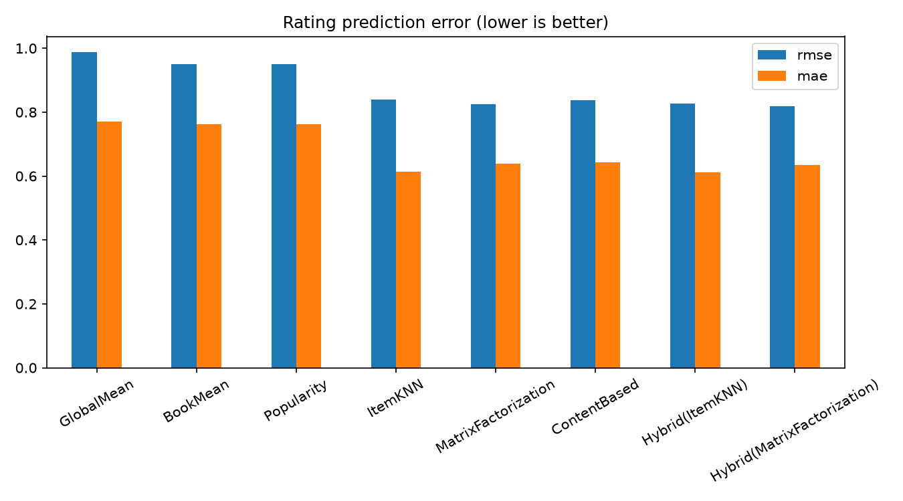
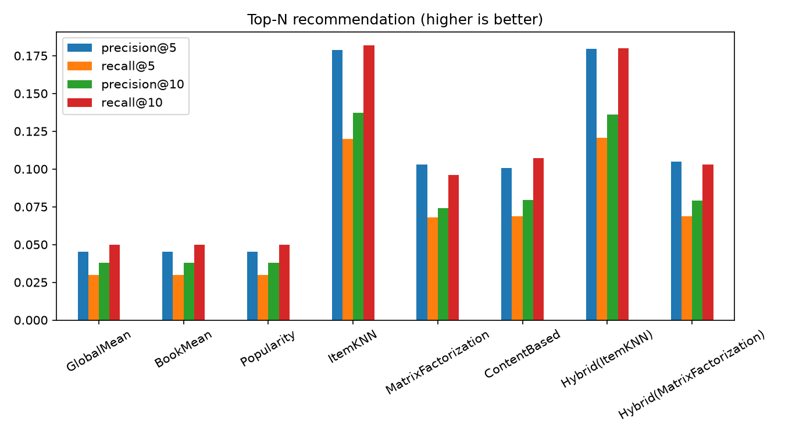

# Goodbooks Recommender

Book recommendation system on Goodbooks-10k using collaborative, content-based, and hybrid filtering.
Team 7, Machine Learning course (2026).

## Overview

The system predicts how a reader would rate unread books and recommends the Top-N books,
combining Goodreads user ratings with book tags and author information.

We implement and compare four filtering methods under the same data split and metrics:

| Method | Model | File |
| --- | --- | --- |
| Collaborative (memory-based) | Item-based KNN | `src/models/knn.py` |
| Collaborative (model-based) | Matrix Factorization (SGD, L2 regularization) | `src/models/mf.py` |
| Content-based | TF-IDF on tags, authors, titles + cosine similarity | `src/models/content.py` |
| Hybrid | Weighted blend of CF and content scores | `src/models/hybrid.py` |

Baselines (global mean, book mean, popularity) are in `src/models/baseline.py`.

## Dataset

[Goodbooks-10k](https://github.com/zygmuntz/goodbooks-10k): 10,000 books, 53,424 users, about 6 million ratings (1–5).
The raw data is not included in this repository. See [`data/README.md`](data/README.md) for download instructions.

## Project Structure

```
goodbooks-recsys/
├── data/            # raw data (not tracked, see data/README.md)
├── notebooks/       # EDA and experiments
├── results/         # figures and result tables
└── src/
    ├── preprocess.py    # loading, preprocessing, train/val/test split
    ├── evaluate.py      # RMSE, MAE, Precision@K, Recall@K
    └── models/
        ├── base.py      # common Recommender interface
        ├── baseline.py
        ├── knn.py
        ├── mf.py
        ├── content.py
        └── hybrid.py
```

All models inherit from `Recommender` in `src/models/base.py` and implement:

- `fit(train)`: train on rating data
- `predict(user_id, book_id)`: predicted rating (1–5)
- `recommend(user_id, k)`: Top-k unrated book IDs

## Getting Started

```bash
git clone <this-repo-url>
cd goodbooks-recsys
pip install -r requirements.txt
# download the dataset into data/ (see data/README.md)
```

## Evaluation

- Split: per-user random hold-out into train / validation / test (seed 42)
- Rating prediction: RMSE, MAE
- Top-N: Precision@K, Recall@K (K = 5, 10), ratings ≥ 4 treated as relevant
- Cold-start: most ratings of selected books are hidden to compare methods
- Hyperparameters are tuned on the validation set only; the test set is used once at the end

## Results


Final evaluation on the test set, run once (50,000 ratings for RMSE/MAE, 2,000 users for Top-N, seed 42).

| Model | RMSE | MAE | P@5 | R@5 | P@10 | R@10 |
|---|---|---|---|---|---|---|
| BookMean | 0.9509 | 0.7620 | 0.0452 | 0.0298 | 0.0378 | 0.0499 |
| Popularity | 0.9509 | 0.7620 | 0.0452 | 0.0298 | 0.0378 | 0.0499 |
| ContentBased | 0.8374 | 0.6437 | 0.1007 | 0.0688 | 0.0795 | 0.1073 |
| MatrixFactorization (n_factors=100, reg=0.02) | 0.8247 | 0.6383 | 0.1031 | 0.0678 | 0.0742 | 0.0960 |
| ItemKNN (k=40, pearson) | 0.8396 | 0.6147 | 0.1788 | 0.1200 | 0.1372 | 0.1818 |
| Hybrid (ItemKNN, alpha=0.9) | 0.8269 | 0.6106 | 0.1796 | 0.1208 | 0.1360 | 0.1800 |
| Hybrid (MF, alpha=0.9) | 0.8195 | 0.6348 | 0.1047 | 0.0688 | 0.0791 | 0.1030 |

- Rating prediction: Hybrid (MF) has the lowest RMSE (0.8195).
- Top-N recommendation: ItemKNN has the highest Precision@10 (0.1372); Hybrid (ItemKNN) is close (0.1360) with a lower RMSE.
- Cold start (500 books with 5 training ratings each): only ContentBased still recommends (P@10 0.0358, RMSE 0.8337). See `results/results_cold_start.csv`.




## Contributing (team workflow)

1. Never push directly to `main`.
2. Create a branch per task: `feature/<name>` (e.g. `feature/knn`).
3. Open a pull request; at least one teammate reviews before merging.
4. Cite any external code (including AI-generated code) in comments, and explain
   functions and parameters not covered in class.

## Team


## License

[MIT](LICENSE)
